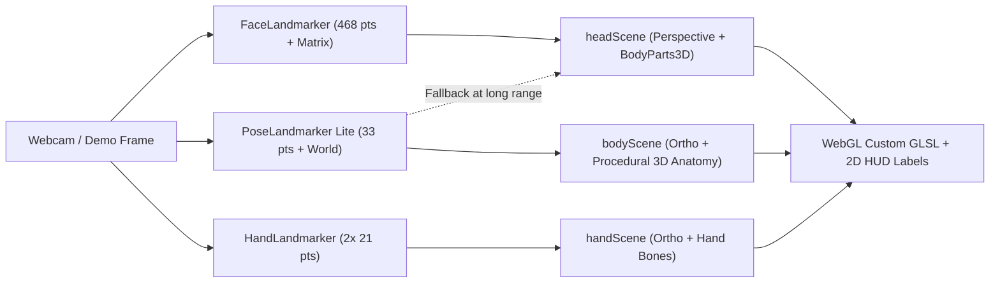

<div align="center">

# 🩻 X-Ray Mirror

### Real-time browser AR anatomy mirror powered by Three.js & MediaPipe

Overlay a live, interactive **3D skull, brain, full-body skeleton, beating organs, muscles, and hand bones** onto your webcam feed — in a single self-contained HTML file.

<p>
  
  
  
  
</p>

[Quick Start](#-quick-start) • [Features](#-features) • [Controls](#-controls--modes) • [Architecture](#-how-it-works) • [Demo Mode](#-demo-mode-no-camera)

</div>

---

## ✨ Features

<table>
  <tr>
    <td width="50%" valign="top">
      <h3>💀 Head & Facial Tracking</h3>
      <ul>
        <li>High-detail 3D cranium, cerebrum, hindbrain, eyeballs, and facial muscles.</li>
        <li>Live jaw articulation driven by MediaPipe <code>jawOpen</code> blendshapes.</li>
        <li>2D-to-3D projection auto-fit + manual calibration sliders persisted in <code>localStorage</code>.</li>
        <li>Automatic pose-based head fallback when stepping far from the camera.</li>
      </ul>
    </td>
    <td width="50%" valign="top">
      <h3>🦴 Full-Body & Upper-Body Tracking</h3>
      <ul>
        <li><strong>Skeleton:</strong> 18-vertebra spine, 11-pair ribcage & sternum, clavicles, scapulae, pelvis, humeri, radius & ulna, femurs, patellae, tibia & fibula, and feet.</li>
        <li><strong>Organs:</strong> beating heart, breathing lungs & trachea, liver, stomach, kidneys, and intestines.</li>
        <li><strong>Desk-friendly:</strong> synthesizes a torso anchor when hips are out of frame.</li>
      </ul>
    </td>
  </tr>
  <tr>
    <td width="50%" valign="top">
      <h3>🖐️ Dual Hand Bone Tracking</h3>
      <ul>
        <li>Simultaneously tracks up to two hands via <code>HandLandmarker</code>.</li>
        <li>Renders 3D carpal/metacarpal palm and phalanx bone segments synced with your forearms.</li>
        <li>Fingertip-tracked <strong>X-Ray Lens</strong> follows your index finger across the screen.</li>
      </ul>
    </td>
    <td width="50%" valign="top">
      <h3>🎨 Custom X-Ray & Solid Shaders</h3>
      <ul>
        <li><strong>X-Ray Mode:</strong> additive Fresnel rim-glow shader with edge feathering and neck fade.</li>
        <li><strong>Solid Mode:</strong> depth-tested, lit 3D anatomical shading.</li>
        <li><strong>Mixed Reality:</strong> blend your real camera image, slice along X/Y planes, or inspect via movable lens.</li>
      </ul>
    </td>
  </tr>
</table>

---

## 🚀 Quick Start

> **Zero build tools required.** Just serve `xray.html` over `localhost` (required by browsers for camera access and ES module imports).

```bash
# 1. Clone the repository
git clone https://github.com/<your-username>/xray-mirror.git
cd xray-mirror

# 2. Start a local static server
python -m http.server 8000
```

Open **Chrome** or **Edge** and visit:

| Mode | URL | Description |
| :--- | :--- | :--- |
| **Live Mirror** | [`http://localhost:8000/xray.html`](http://localhost:8000/xray.html) | Click **Start camera** and allow webcam access |
| **Demo Scene** | [`http://localhost:8000/xray.html#demo`](http://localhost:8000/xray.html#demo) | Instant full-body + head + hand preview with no camera |

> **Note:** Internet access is needed on first load to fetch Three.js (`0.160.0`), `@mediapipe/tasks-vision` (`0.10.14`), and the MediaPipe `.task` models from CDN. All video processing stays strictly on your device.

---

## 🎛️ Controls & Modes

| Group | Options |
| :--- | :--- |
| **Presets** | `Skull` · `Full skeleton` · `Organs` · `Brain` · `Muscles` · `Everything` |
| **Layers** | `Skull`, `Body bones`, `Brain`, `Organs`, `Muscles`, `Eyes`, `Body outline`, `Hand bones`, `Show labels` |
| **Look** | `X-ray` (glowing rim shader) · `Solid` (lit 3D anatomy) · `Brightness` |
| **Mixed Reality** | `Real me showing through` · `Edge feather` · `Reveal` (`Whole head`, `Left/Right half`, `Top/Lower`, `X-ray lens`) |
| **Calibration & Debug** | `Fit to my head` (scale, W/H/D, X/Y/Z) · `Show tracking data` (landmarks, pose skeleton, FPS) |

---

## 🧠 How It Works



<details>
<summary><strong>Under the hood: architecture details</strong></summary>

- **Single-file delivery (`xray.html`):** Embeds quantized `Uint16` BodyParts3D head/hand mesh buffers (`#meshmeta` + `#meshdata`) alongside procedural `THREE.BufferGeometry` generators (`buildBodyGeos`) for the spine, ribcage, limbs, organs, and muscles.
- **Layered compositor:** Stacks `<video>`, a 2D veil canvas (`#shade`), a transparent Three.js WebGL canvas (`#gl`), and a 2D HUD canvas (`#hud`) for collision-free anatomical callout labels and debug overlays.
- **Hardware acceleration:** Attempts MediaPipe `GPU` delegate first and seamlessly falls back to `CPU` if WebGL delegates are unavailable.

</details>

---

## 🧪 Demo Mode (No Camera)

Test rendering, shaders, and layout directly without a webcam:

- `xray.html#demo` — Animated standing full-body skeleton, head, and hand.
- `xray.html#demo?still` — Pauses animation at a fixed frame.
- `xray.html#demo?dump` — Flattens all canvas layers into a single PNG `` overlay for visual inspection.

---

## ⚠️ Disclaimer & Credits

- **Not a medical tool:** Anatomy is a generalized adult reference model aligned to your pose for education and visualization—it is not a scan of your body.
- **3D Head & Hand Models:** [BodyParts3D](https://lifesciencedb.jp/bp3d/) © The Database Center for Life Science, licensed under [CC Attribution-Share Alike 2.1 Japan](https://creativecommons.org/licenses/by-sa/2.1/jp/) (models simplified and re-aligned).
